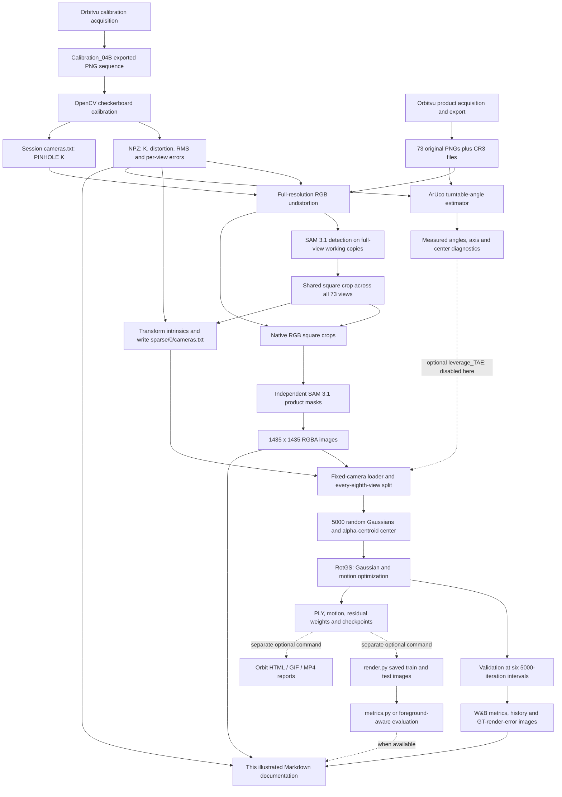

# Current end-to-end 3D scanning and RotGS reconstruction pipeline

> Historical pipeline snapshot: generated on 13 October 2026 using R080 / `pyds8296`. The filename and location changed on 15 October; the experiment and evidence date did not. Use the [maintained pipeline guide](../pipeline.md) and [objective overview](../experiments/README.md) for navigation and subsequent work.

**Generation date:** 13 October 2026 (Europe/Zurich).  
**Example run:** `pyds8296` — `quoellfrisch-top-s04-sam31ac1435-noTAE-noLR`.  
**Associated dataset:** `cleaned/Session_04/4_Quoellfrisch_Top_30d_SAM31AC_1435`, 73 RGBA images at 1435 × 1435 pixels.  
**Documentation basis:** current working tree, saved run configuration, acquisition records, calibration arrays, preprocessing diagnostics, training logs, saved Gaussians, and authenticated read-only W&B history.

## Executive summary

The implemented physical workflow uses an Orbitvu ALPHASHOT 360 lighting system and TURNTABLE 360, with a stationary Canon EOS R7 and RF-S18-150mm F3.5-6.3 IS STM lens. A calibration sequence establishes the camera model at the exported image resolution. Product sequences contain 72 nominal five-degree views plus a closing exposure, yielding 73 images from nominal 0° to 360°. In the selected example, the target is a blue Quöllfrisch beer can photographed from a nominal 30° top-view configuration. These details are supported by the acquisition records and source imagery; the exact zoom position and a photograph of the complete apparatus are unavailable. [E6] [E7]

The example uses **plain checkerboard calibration**, despite the repository also supporting ChArUco. OpenCV estimated a camera matrix and five distortion coefficients from 49 accepted images. Preprocessing undistorted the exported 6751 × 4501 PNGs while preserving the numerical camera matrix, discovered a shared square crop with SAM 3.1, regenerated product alpha, and wrote 1435 × 1435 training images. The focal lengths remain approximately 5967 and 5965 pixels; cropping shifts the principal point from `(3402.722, 2185.450)` to `(772.722, 285.450)`. The implemented transformation reproduced the saved camera file exactly during this report's verification. [E1] [E2] [E3] [S2] [S3]

RotGS reconstructs one canonical Gaussian model and rotates its centers, orientations, and a subset of its spherical harmonic coefficients about an optimized axis and center. The camera itself is fixed. This latest run starts from 5,000 random points, uses alpha-aware RGB and silhouette losses, grows to **139,686 Gaussians**, and completes 30,000 iterations. It disables optical flow, measured turntable-angle input, and local residual angles, but **retains a learned global sweep correction**. The final held-out averages are **25.9789 dB full-frame PSNR**, **24.0486 dB foreground PSNR**, and **0.773092 foreground-bounding-box SSIM** over ten views. LPIPS and a standalone `results.json` are unavailable for this run. [R1] [R2] [S5] [S7]

The result preserves the product silhouette, label colors, and general shape, with visible blur and distortions in the metallic lid and fine print. The implementation provides a traceable appearance-reconstruction workflow. This experiment does not establish metrological shape accuracy, a watertight surface, or quality at unobserved elevations. The report can support technical project documentation and a thesis methodology draft, subject to the provenance and measurement limitations identified below.

## Evidence conventions and scope

- **VERIFIED** means directly established by current source code, saved metadata, an artifact, a calculation using the implemented helper, or a read-only API record.
- **INFERRED** means indirectly supported, including relationships between relocated artifacts and their original output locations. It does not imply an experimentally established cause.
- **UNAVAILABLE** means the inspected evidence does not resolve the information. No substitute measurement is invented.

Sections marked VERIFIED can describe either the **current implementation** or the **selected recorded run**; those are distinguished explicitly where defaults, optional branches, or source provenance matter. Current code was inspected on 13 October 2026. The run's W&B configuration records commit `b98df0c7abfebfe5715d78ae1f08dacddf6e5ffd` and `git_dirty=True`. Therefore, a commit checkout alone cannot establish an identical historical source tree. Hashes of the source files inspected for this report are retained in the [asset manifest](/shared/datasets/3D_Scanning_MT/output_RotGS/reports/pipeline/2026-10-13/assets/current_pipeline_latest_run/asset_manifest.json). [R3]

The report generator copied small evidence files and created figures **only under `Session Saves`**. It did not train, invoke reconstruction rendering, recalibrate the camera, or rewrite experimental outputs. Figures combine actual source images, existing W&B comparisons, saved numerical measurements, and saved Gaussian centers. The corner overlay is a newly computed visualization on an existing accepted calibration image; it is not a new calibration result. Original files are preserved.

## High-level workflow overview

The operational stages are separate entry points rather than one master application. Orbitvu acquisition and export occur outside the Python repository. The calibration and preprocessing tools exchange NPZ and COLMAP-style camera files. Training saves a canonical Gaussian model and motion state. In-training validation logs numerical metrics and comparison images to W&B. Separate rendering/evaluation/report tools exist, but were not executed for the selected run's external evaluation. [S1] [S3] [S5] [S10] [S11]



## Selected example run and selection audit

| Field | Selected evidence |
|---|---|
| W&B run ID | `pyds8296` |
| Recorded name | `quoellfrisch-top-s04-sam31ac1435-noTAE-noLR` |
| Online record | [W&B run](https://wandb.ai/3D-Scanning-MT/RotGS/runs/pyds8296), state `finished` |
| W&B creation | 7 October 2026, 17:35:11 CEST; API timestamp `2026-10-07T15:35:11Z` |
| Final PLY modification | 7 October 2026, 18:06:39 CEST; filesystem timestamp `16:06:39.275795 UTC` |
| Training completion | Log: 18:06:42 CEST; queue `DONE`: 18:06:44 CEST |
| Iterations | 30,000; matching final PLY, Gaussian checkpoint, residual weights, evaluation and W&B summary |
| Output | `/shared/datasets/3D_Scanning_MT/output_RotGS/session_04/4_Quoellfrisch_Top_30d_SAM31AC_1435_noTAE_noLR_30k` |
| Training dataset | `/shared/datasets/3D_Scanning_MT/cleaned/Session_04/4_Quoellfrisch_Top_30d_SAM31AC_1435` |
| Original exports | `/shared/datasets/3D_Scanning_MT/orbitvu/exports/Session_04/4_Quoellfrisch_Top_30d` |
| Calibration | `/shared/datasets/3D_Scanning_MT/orbitvu/exports/Session_04/Calibration_04B/camera_calibration.npz` |
| Acquisition date strings | Product `2026-09-24 16:13:52.347347`; calibration `2026-09-24 15:44:40.912912`; no timezone stored |
| Prepared-sequence diagnostics | `sam31-uxiinlqj`, completed 6 October 2026 at 16:49:03 CEST |
| W&B runtime | 1887 seconds; trainer progress about 31 min 17 s; queue start-to-DONE 31 min 36 s |

**VERIFIED selection:** a recursive inventory found 53 `cfg_args` run configurations under the shared RotGS outputs and repository `output`, including 49 with a PLY at their configured final iteration. This is an artifact-presence audit, not a claim that every historical run with such a PLY is independently proven complete. The selected run has the newest final PLY and additionally has explicit `Training complete`, a successful queue exit, and a finished online record. A read-only audit of the 20 newest W&B runs, ordered by creation time, also places `pyds8296` first. No newer identifiable complete run was found in those inspected sources. [A1] [A2] [R4]

| Recent comparator | Final PLY UTC, 7 October 2026 | Online completion |
|---|---|---|
| **`pyds8296` — nominal angles, local residual off** | **16:06:39** | **finished, 30,000** |
| `x68bbab4` — nominal angles, local residual enabled | 15:34:54 | finished, 30,000 |
| `duiwndaw` — TAE, local and global corrections off | 15:03:43 | finished, 30,000 |
| `78gbr4c6` — TAE local residual, global correction off | 14:26:01 | finished, 30,000 |
| `w5cs4xiu` — TAE, local residual off | 13:46:18 | finished, 30,000 |

The existing shared `RUN_LOG.md` was last written before the latest runs finished: it still labels `duiwndaw` as running and does not index the selected run. It is useful historical documentation but is superseded here by checkpoints, queue completion, and W&B. [D1]

# Chapter 1 — Checkerboard / ChArUco calibration scan

## 1.1 Purpose and actual physical acquisition

Calibration determines the projection from camera-frame rays to pixels and estimates lens distortion. It supplies the camera matrix consumed during undistortion and reconstruction; it does not solve the product's complete geometry or directly supply all RotGS poses.

**VERIFIED:** the selected calibration is `Calibration_04B`, acquired with Orbitvu Station 2025 **25.1.7**, Canon EOS R7, and the same recorded RF-S18-150mm lens and main-exposure settings as the product sequence. Images show the checkerboard in differing orientations on the turntable. The marker-covered product setup is documented separately in Chapter 2. The export contains **73 PNG images**, all **6751 × 4501** pixels, plus **73 CR3 raw files**. Header inspection found 72 RGB PNGs and one RGBA PNG. The calibration script reads grayscale/RGB and does not use alpha as geometric evidence. [E1] [E7] [S1]

**UNAVAILABLE:** a complete setup photograph, independently measured lens zoom/focus position, camera support geometry, a board-flatness measurement, and a written board-positioning protocol. The varied orientations visible in the photographs are evidence; a prescribed hand-moved calibration procedure cannot be asserted. Acquisition metadata date strings do not store their timezone.


*Figure 1.1 — Actual `Calibration_04B_1_0.png`, downsampled for documentation. The checkerboard is the intrinsic-calibration target. Product-sequence markers used for angle estimation are shown separately in Chapter 2.*

## 1.2 Board geometry and supported target branches

The saved NPZ identifies **`board_type="checkerboard"`**, **9 × 14 physical squares**, **20 mm square side length**, and an **8 × 13 internal-corner grid**, hence **104 corners per accepted view**. The nominal square-array extent is **180 × 280 mm**, calculated from the recorded square counts and side length; this is not a separate measurement of the paper or its margins. The internal-corner coordinate spans are 140 × 240 mm. The plain checkerboard has no ArUco dictionary. [E1]

The current `get_camera_intrinsics.py` also implements a **ChArUco branch**, which is not used by the example. Its current defaults are 9 × 12 squares, 30 mm square length, 22 mm marker length, and at least 15 detected ChArUco corners. It tests `DICT_5X5_50`, `DICT_5X5_100`, `DICT_5X5_250`, and `DICT_5X5_1000`, ranks marker detections, constructs `CharucoBoard`, enables `setLegacyPattern(True)`, and detects with `CharucoDetector.detectBoard`. Calibration calls `calibrateCameraCharuco` when available, otherwise uses matched board/image points with `calibrateCamera`. These are current implementation choices; no ChArUco board or chosen ChArUco dictionary is claimed for `Calibration_04B`. [S1]

## 1.3 Detection, estimation, commands and outputs

`run_checkerboard_calibration` builds a planar metric object-point grid, using one fewer corner than physical squares in each dimension. Current detection uses `cv2.findChessboardCornersSB` with normalization, exhaustive search and accuracy flags. The default detection-width limit is 2400 pixels; coordinates are transformed back to native resolution and refined with `cornerSubPix`, an 11 × 11 window, 50 iterations maximum and epsilon 0.001. It rejects unreadable images, mismatched resolutions and incomplete detections, and requires at least five valid images. `cv2.calibrateCamera` jointly estimates intrinsics, distortion and board extrinsics. Per-view RMS errors are then calculated with `projectPoints`. [S1]

**VERIFIED historical outputs:** 49 accepted filenames and 49 errors are saved. Of the 73 present source PNGs, 24 are absent from the accepted list. **UNAVAILABLE:** the historical rejection reasons, calibration terminal log, exact shell invocation and exact historical detection-width setting. Current detection was replayed on one accepted frame only to create Figure 1.2; the stored calibration was not recomputed.

The following is a **metadata-consistent replay command, not a recovered historical command**. The board dimensions match the NPZ. It would write calibration outputs if executed; it was not run for this report.

```bash
cd /workspaces/RotGS
.venv/bin/python tools/calibration/get_camera_intrinsics.py \
  /shared/datasets/3D_Scanning_MT/orbitvu/exports/Session_04/Calibration_04B \
  --board checkerboard --squares-x 9 --squares-y 14 --square-size-mm 20
```

The checkerboard function writes:

- `Calibration_04B/camera_calibration.npz`: `camera_matrix`, `dist_coeffs`, `rms`, `image_size`, target dimensions, accepted filenames and per-view errors.
- Parent `Session_04/cameras.txt`: one `PINHOLE` entry containing resolution and `fx fy cx cy`, with 17 significant digits. It does **not** contain distortion coefficients.

The latter file alone cannot correct distortion; downstream preprocessing must also load the NPZ. The two calibration outputs agree, and their hashes match the preprocessing metadata: NPZ SHA-256 `ffc8225aed551b293838eef663d3e67bebf12713e17bb9939941eef1678c5a51`; source camera text SHA-256 `55d0a3e691c840a24ec700879a59ddb8ed23d5e9b8fcd24b4f71fb30c90aa647`. [E1] [E2] [E3]


*Figure 1.2 — Newly generated detection overlay on the same accepted source frame, using the current checkerboard detection/refinement procedure. All 104 internal corners were found. This figure illustrates detection and does not replace the saved calibration.*

## 1.4 Resulting intrinsics, distortion and diagnostics

At the **exported calibration resolution**, the saved matrix is:

```text
K_calibration =
[ 5966.998465766       0.000000000   3402.721863224 ]
[    0.000000000    5965.107619729   2185.449953690 ]
[    0.000000000       0.000000000      1.000000000 ]
```

All focal lengths and principal-point coordinates are in pixels. More digits are retained in [calibration arrays](/shared/datasets/3D_Scanning_MT/output_RotGS/reports/pipeline/2026-10-13/assets/current_pipeline_latest_run/evidence/calibration_arrays.json).

The OpenCV five-coefficient distortion vector, in `(k1, k2, p1, p2, k3)` order, is approximately:

```text
[-0.143555646, 0.0893102964, -0.00167627871, 0.0000246569302, 0.0717337008]
```

These are dimensionless normalized-coordinate coefficients. For normalized ideal coordinates `(x,y)`, with `r²=x²+y²`, the model is:

```text
radial = 1 + k1 r² + k2 r⁴ + k3 r⁶
x_distorted = x radial + 2 p1 x y + p2 (r² + 2 x²)
y_distorted = y radial + p1 (r² + 2 y²) + 2 p2 x y
u = fx x_distorted + cx;  v = fy y_distorted + cy
```

| Diagnostic | Saved value |
|---|---:|
| Global OpenCV RMS reprojection error | 0.769725334 px |
| Accepted views | 49 / 73 present exported PNGs |
| Minimum per-view RMS | 0.126949 px |
| Median per-view RMS | 0.307566 px |
| Mean per-view RMS | 0.523802 px |
| Maximum per-view RMS | 2.777054 px |
| Highest-error accepted frame | `Calibration_04B_31_150.png` |

The global RMS and simple mean of per-view RMS are different aggregates and should not be equated. The high-error tail is observed; its cause is unavailable. There is no saved uncertainty covariance, held-out calibration test, or target-flatness assessment. A low reprojection residual alone does not prove physical calibration accuracy. [E1]


*Figure 1.3 — Stored per-view reprojection errors, ordered by nominal acquisition angle. The dashed line is the stored global RMS, not an acceptance threshold.*

# Chapter 2 — Product scan / image acquisition

## 2.1 Purpose, apparatus and relative motion

Product acquisition records different appearances while the **camera remains stationary** and the **product and attached marker layout rotate together**. Training represents this relative motion by rotating a canonical object under a fixed camera. Images show the upright beer can, surrounding fiducials, and other material outside the product region. [E6] [S4] [S7]

The product session records Orbitvu Station 2025 25.1.7, ALPHASHOT 360 lighting and TURNTABLE 360. The main camera settings are identical across all 73 recorded exposures:

| Item | Recorded setting | Evidence boundary |
|---|---|---|
| Camera | Canon EOS R7 | Recorded device model |
| Lens | RF-S18-150mm F3.5-6.3 IS STM | Lens identity; selected focal length unavailable |
| Aperture | f/8 | Main exposure |
| Shutter speed | 1/200 s | Main exposure |
| ISO | 100 | Main exposure |
| White balance | Color temperature, 5000 K | Stored camera settings |
| In-camera acquisition | `RAW + Jpeg Large Normal` | Workspace JPEG/CR3 references |
| Lighting device values | `[0,0,0,0,50,50,50,50]` | Orbitvu control values; physical units/calibration unavailable |
| Nominal camera elevation | `30d` in session name | Physical estimator reports 30.073694° relative to its reference table plane |
| Exported source images | 73 PNGs, 6751 × 4501, RGBA | All file headers checked |
| Raw companions | 73 `.cr3` files | Present; raw pixels not used by preprocessing |

Orbitvu also stores mask-exposure settings f/13, ISO 200 and 1/500 s. These belong to its mask acquisition, not the main product photographs. The subsequent SAM preprocessing discards source alpha and regenerates segmentation, so the existence of Orbitvu masks does not mean they supervise this reconstruction. [E6] [E2] [S3]

**UNAVAILABLE:** a real photograph showing the complete scanner, camera mounting position, working distance measured independently, turntable speed or settling time, exact zoom/focus, and light output in photometric units. The source frames are actual product photographs and show part of the scene, but are not a complete apparatus photograph.


*Figure 2.1 — Actual exported source RGB at nominal 0°, 90°, 180° and 270°. The PNG alpha is deliberately ignored in this display, as it is in the SAM RGB input; the images expose the surrounding turntable markers. These are not synthetic setup illustrations.*

## 2.2 Sequence, export and naming

**VERIFIED:** the export and preprocessing metadata contain angles **0, 5, 10, …, 360°**. Seventy-two five-degree intervals span one nominal revolution; the closing image is an additional exposure, not a byte-duplicate of the first file. In `session.json`, its wrapped turntable value is 0°, while its export filename and preprocessing metadata use 360°. Thus there are 73 exposures and 72 distinct nominal orientations modulo a revolution. [E2] [E6]

Source filenames follow:

```text
4_Quoellfrisch_Top_30d_1_0.png
4_Quoellfrisch_Top_30d_2_5.png
...
4_Quoellfrisch_Top_30d_73_360.png
```

The acquisition workspace uses UUID-based JPEG and CR3 references. `publish.json` records a 360 export profile with 144 URLs—72 PNG/CR3 pairs—and a single-image profile with two URLs for the closing PNG/CR3 pair. The recorded Windows publishing destination is `C:/Users/thoel/orbitvu/publishing/4_Quoellfrisch_Top_30d/...`; the available Linux mirror is the `orbitvu/exports/Session_04` directory. [E8]

**INFERRED:** the workspace assets, export names, common session identity and complete angle sequence support their correspondence. The export profile implementation, file-transfer command, precise JPEG/RAW-to-PNG conversion recipe, and UUID-to-filename manifest are unavailable. The workspace stores graphic-operation/crop rectangles, but their exact relation to the PNG raster is not proven. Therefore, the calibration matrix is documented at **6751 × 4501 exported pixels**, not back-projected to an assumed full sensor raster. Calibration and product exports share this resolution, and preprocessing checks it explicitly. [S2]

`detect_angle_order` identifies the integer token forming the complete five-degree sequence, sorts numerically by angle, and assigns zero-padded training names `0000.png` through `0072.png`. For this sequence, `angle_token_from_right=0`. This step prevents lexicographic mistakes such as placing frame 10 before frame 2. The complete original-to-prepared mapping remains in `preprocessing_metadata.json`. [E2] [S3]

## 2.3 Acquisition observations and risks

**VERIFIED observations:** the metallic lid contains bright reflections; the product label has fine print and textured illustrations; there are markers and unrelated material around the product. The saved ArUco fit measures a 359.133883° sweep, not exactly 360°, and step variation is documented in Chapter 3. [E4]

**General risks, not established failures:** motion during exposure, focus drift, nonrigid packaging, inconsistent lighting, lens-setting changes, specular reflections, object sliding relative to the turntable, and mechanical rotation errors can reduce reconstruction quality. The measured closure departure establishes nonnominal fitted table motion under the estimator's assumptions; it does not establish product slip. Product-to-table rigidity was not separately measured. The report does not attribute the final blur to any one of these risks without evidence.


*Figure 2.2 — Display-only crops from the original nominal-zero export, showing the reflective lid and product-label detail. No sharpening, inpainting or generated content is used.*

The acquisition-stage outputs become preprocessing inputs without any reconstruction-specific camera-pose file. The source angle token establishes ordering, the calibration establishes image geometry, and separate table-marker analysis can establish physical motion. The selected run ultimately uses nominal rather than measured angles.

# Chapter 3 — Preprocessing and intrinsics transformation

## 3.1 Purpose, entry point and recovered invocation

Preprocessing removes irrelevant scene content from supervision while maintaining the correct projection geometry. The selected dataset uses `prepare_rotgs_sequence_SAM31.py`, with helper geometry from `prepare_rotgs_sequence_png.py` and `prepare_rotgs_sequence.py`, and shared review/prompt utilities from the SAM 2.1 adapter. Importing shared utilities does **not** mean this dataset was segmented by SAM 2.1. [S2] [S3] [S12]

**VERIFIED recorded invocation:** the diagnostics capture the executable, argument vector and environment. Expressed as a shell command from the repository root, these recorded values are:

```bash
cd /workspaces/RotGS
CUDA_LAUNCH_BLOCKING=1 TORCH_SHOW_CPP_STACKTRACES=1 \
.venv-sam31/bin/python tools/preprocessing/prepare_rotgs_sequence_SAM31.py \
  /shared/datasets/3D_Scanning_MT/orbitvu/exports/Session_04/4_Quoellfrisch_Top_30d \
  --cameras /shared/datasets/3D_Scanning_MT/orbitvu/exports/Session_04/cameras.txt \
  --calibration /shared/datasets/3D_Scanning_MT/orbitvu/exports/Session_04/Calibration_04B/camera_calibration.npz \
  --checkpoint checkpoints/sam31/sam3.1_multiplex.pt \
  --text-prompt 'beverage can' \
  --diagnostics-dir /shared/datasets/3D_Scanning_MT/orbitvu/exports/Session_04/sam31_diagnostics \
  --cuda-sync
```

This reconstructs the recorded process invocation and environment, not an unknown outer shell launcher. The recorded Python is **3.12.13**, PyTorch **2.10.0+cu128**, SAM package **0.1.0**, NumPy **1.26.4**, and Pillow **12.3.0**. The local SAM 3.1 checkpoint is explicit; the adapter does not download weights. The current builder uses `version="sam3.1"`, disables FlashAttention 3, compilation and warm-up, and requires CUDA with bfloat16 support. The main training environment is separate. These dependency requirements are derived from the adapter and diagnostics, not assumed from the model name. [E5] [S3]

The diagnostics record completion at `2026-10-06T14:49:03.555285+00:00`, after 247.5841 seconds, and an original output directory beside the source exports. The corresponding directory is now absent there, while the training configuration points to the present `cleaned/Session_04/...` directory. Crop, naming, settings, prompt recovery identifier and diagnostic results agree with the current prepared metadata. **INFERRED:** the dataset was relocated after successful preprocessing. **UNAVAILABLE:** a recorded move/copy command or immutable manifest captured before relocation. The original source images and calibration remain accessible.

## 3.2 Complete actual processing order

The selected execution uses automatic crop discovery and independent concept detection, with no browser editing and no requested final downscale. [E2] [E5] [S3]

| Order | Implemented operation | Selected settings / input | Intermediate or final output |
|---:|---|---|---|
| 1 | Validate and order source PNGs | 73 same-size PNGs; rightmost angle token | Ordered list and `0000`–`0072` output names |
| 2 | Load source camera and NPZ | 6751 × 4501; matching K and image size | Undistortion maps and valid-pixel map |
| 3 | Undistort RGB for crop discovery | OpenCV linear remap, output K identical to input K | Full-size corrected views, then 1600 × 1067 temporary JPEG detection copies |
| 4 | Detect product independently in every full view | SAM 3.1; `beverage can`, fallback `can`; probability threshold 0.5 | Per-view native-coordinate bounds and their union |
| 5 | Construct shared smallest square | Union `(2932,1910,3764,3325)`; 10 native pixels margin | Crop `(2630,1900,4065,3335)`, 1435 × 1435 |
| 6 | Undistort sources again and extract native crop | Source alpha discarded | Lossless temporary RGB crops; 1435 × 1435 temporary JPEG inference copies; crop-review thumbnails |
| 7 | Estimate table motion on original uncropped sources | NPZ distortion, 40 mm black ArUco side | `turntable_angle_estimation/` CSV, summary, plots and annotated images |
| 8 | Run final cropped-product segmentation | Independent per-frame concept; working size 1435 × 1435 | Binary alpha masks, recovery prompt JSON |
| 9 | Attach masks to native RGB crops | Nearest-neighbor alpha to crop size; final LANCZOS resize call | Final RGBA PNGs; size unchanged here |
| 10 | Generate review and statistics | 73 views; no crop-edge warnings | `mask_review/`, alpha statistics |
| 11 | Transform camera intrinsics | Undistorted K, shared crop, output dimensions | `sparse/0/cameras.txt` with final PINHOLE K |
| 12 | Write metadata/prompts and publish staged folder | Existing destinations refused | Complete prepared sequence, published after all steps succeed |

Temporary JPEG images are inference aids, stored at quality 100 with subsampling disabled. Final RGB comes from lossless native-resolution crops, not from those JPEGs or from a generated SAM image. Temporary files are cleaned up. The source-alpha behavior is recorded as `discarded_then_regenerated_after_undistortion` and `source_alpha_used=False`. No JPG-to-PNG helper is executed in this selected sequence: the inputs are already PNGs. [S3]

The crop-discovery pass preserves disconnected components belonging to the selected mask, maps detection bounds outward to native undistorted coordinates, and unions all views. Automatic detection rejects foreground touching the full-image boundary and rejects a square extending into invalid undistortion pixels. Its union has width 832 and height 1415; adding 10 pixels on each side makes the limiting height 1435. The resulting square contains actual image pixels. The term “margin” describes extra crop content; it is **not inserted image padding**. [S3]

The second pass segments the product again from its native RGB crop, rather than reusing full-view masks. `detect_masks` passes `preserve_components=True`; the current automatic branch preserves holes and disconnected selected-object components, with no hole filling or erosion. The shared `product_component` helper can select components in other prompt-guided branches, but that is not the selected automatic path. Detection tries the full text, its last word, then crop-box alternatives if needed; masks covering at least half the perimeter are rejected as background candidates. In this run, the crop pass used 69 full-text detections and four text fallbacks; the final pass used 35 full-text detections and 38 `can` fallbacks. No box fallback or manual click correction is recorded. [E5] [S3] [S12]

There is no separate side-artifact cleanup, inpainting or sharpening step in this run. Markers, background and unrelated objects are excluded by the product alpha. Deprecated scripts for JPG conversion, interactive cropping, side-artifact cleanup and flow downscaling remain under `outdated_helper_functions`, but their presence is not evidence of execution. SAM 2.1 and legacy PNG/JPG preprocessing remain alternative entry points, not additional stages in this sequence.


*Figure 3.1 — Original exported RGB; full-size undistorted RGB with the shared square and calibrated principal point; native square crop with its transformed principal point. The red cross moves in image coordinates because of cropping. The crop contains surrounding RGB content until alpha is applied.*

## 3.3 Camera intrinsics: equations and implementation checks

For an ideal pinhole model:

```text
K = [ fx  0  cx ]
    [  0 fy  cy ]
    [  0  0   1 ]
[u, v, 1]^T ∝ K [X/Z, Y/Z, 1]^T
```

A crop whose left/top offsets are `(l,t)` has image-coordinate matrix:

```text
C = [1 0 -l; 0 1 -t; 0 0 1]
K_crop = C K
fx_crop = fx; fy_crop = fy
cx_crop = cx - l; cy_crop = cy - t
```

Resizing from `(Wc,Hc)` to `(Wo,Ho)` applies `sx=Wo/Wc`, `sy=Ho/Hc`:

```text
S = diag(sx, sy, 1)
K_resized = S K_crop
fx_out = sx fx; fy_out = sy fy
cx_out = sx (cx-l); cy_out = sy (cy-t)
```

If a camera file describes a different geometrically compatible source resolution, `transform_camera_intrinsics` first uses `ax=Wsource/Wcamera`, `ay=Hsource/Hcamera`:

```text
fx_out = sx ax fx;   fy_out = sy ay fy
cx_out = sx (ax cx - l);   cy_out = sy (ay cy - t)
```

This is the **actual implemented formula** in `prepare_rotgs_sequence.py::transform_camera_intrinsics`. It uses independent width and height ratios and preserves numerical precision with `.17g` formatting. In the selected SAM/PNG route, the undistortion loader additionally requires exact source/calibration/camera dimensions and matching matrices. Here `ax=ay=sx=sy=1`: none of these resolution factors changes K. [S2] [S3]

For completeness, padding with `p_left` pixels on the left and `p_top` above would give:

```text
P = [1 0 p_left; 0 1 p_top; 0 0 1]
K_padded = P K
fx_padded = fx; fy_padded = fy
cx_padded = cx+p_left; cy_padded = cy+p_top
```

**Padding is not performed in this example**, and the square-crop helper explicitly uses real source pixels. An eight-pixel expansion of the SSIM evaluation bounding box is a clipped region-selection operation, not a modification to training image geometry.

Undistortion is a nonlinear remapping, separate from those affine image transformations. `_load_undistortion` calls:

```python
output_camera_matrix = camera_matrix.copy()
cv2.initUndistortRectifyMap(K, distortion, None, output_camera_matrix,
                          source_size, cv2.CV_32FC1)
```

`_remap_rgb` then applies `cv2.remap` with bilinear interpolation and a white constant border. Thus numerical K is preserved while pixels are rectified to its ideal pinhole model. The accepted crop is checked against map validity, so it contains no pixels mapping beyond the calibrated source bounds. `getOptimalNewCameraMatrix` and a fit of new focal lengths are **not used**. The saved training `PINHOLE` entry has no distortion parameters because the images have already been rectified. Training performs no second undistortion. [S2] [S4]

### Numerical comparison at every relevant geometry stage

The “temporary detection coordinates” row below reports the mathematically scaled K for interpreting that temporary view. The implementation does not write or feed that matrix to a camera loader; it maps boxes back to full resolution. This row is not an intermediate training camera calibration.

| Processing stage | Width × height | fx (px) | fy (px) | cx (px) | cy (px) | Distortion treatment | K operation |
|---|---:|---:|---:|---:|---:|---|---|
| Original calibrated export | 6751 × 4501 | 5966.998466 | 5965.107620 | 3402.721863 | 2185.449954 | Saved five nonzero coefficients | Estimated once by checkerboard calibration |
| Full-size undistorted RGB | 6751 × 4501 | 5966.998466 | 5965.107620 | 3402.721863 | 2185.449954 | Rectified using saved distortion | Output K is a copy of input K |
| Temporary full-view detection coordinates | 1600 × 1067 | 1414.190127 | 1414.079056 | 806.451634 | 518.079338 | Already rectified | Derived scale `1600/6751`, `1067/4501`; no persisted K |
| Native shared square crop | 1435 × 1435 | 5966.998466 | 5965.107620 | 772.721863 | 285.449954 | Already rectified | Subtract left 2630 and top 1900 |
| Cropped SAM inference copy | 1435 × 1435 | 5966.998466 | 5965.107620 | 772.721863 | 285.449954 | Already rectified | Same geometry; JPEG is temporary |
| Final RGBA export / resize call | 1435 × 1435 | 5966.998466 | 5965.107620 | 772.721863 | 285.449954 | Ideal PINHOLE metadata | Unit scale; alpha attachment has no K effect |
| Loaded training camera (`resolution=1`) | 1435 × 1435 | 5966.998466 | 5965.107620 | 772.721863 | 285.449954 | No distortion model in renderer | Loader scale factors both one; K fixed |

The resulting matrix is:

```text
K_training =
[ 5966.998465766       0.000000000    772.721863224 ]
[    0.000000000    5965.107619729    285.449953690 ]
[    0.000000000       0.000000000      1.000000000 ]
```

The principal point is intentionally far above the square's midpoint: it is not reset to the center of the crop. `utils/camera_utils.py::loadCam` forwards all four intrinsics, and `utils/graphics_utils.py::getProjectionMatrix` builds an off-center projection when `legacy_centered_projection=False`, as recorded in this run. Its rasterizer-compatible offsets are `(2cx+1)/W-1` and `(2cy+1)/H-1`. The `+1` follows the pixel-center conversion in the CUDA rasterizer. [R1] [S6]

**VERIFIED calculation:** execution of the current `_cameras_text_with_matrix` and `transform_camera_intrinsics` helpers produced byte-identical final camera text. Full-size maps also confirmed the entire selected crop is valid. The source-derived RGB of prepared image `0000.png` matches the implemented undistort-then-crop operation exactly; all-frame checks are retained separately in the [dataset verification](/shared/datasets/3D_Scanning_MT/output_RotGS/reports/pipeline/2026-10-13/assets/current_pipeline_latest_run/evidence/dataset_verification.json). [V1]

**Alpha masking does not intrinsically change K when width, height and pixel locations remain unchanged.** Here it only changes foreground membership and subsequent compositing/supervision. It is not a recalibration or a camera-pose estimate.

## 3.4 Alpha quality, files and physical turntable diagnostics

The saved alpha statistics are 150,323,425 total pixels across 73 frames:

| Alpha category | Pixels | Fraction |
|---|---:|---:|
| Alpha = 0 | 83,792,737 | 55.741636% |
| 0 < alpha < 255 | 0 | 0% |
| Alpha = 255 | 66,530,688 | 44.258364% |

The mask is binary because final output size equals the native crop size. In a downscaled alternative, final resampling can produce fractional boundary coverage. No frame is flagged as touching the crop edge in the saved review; however, empty review flags are not a measurement of segmentation accuracy. Independent detection produces no adjacent-anchor IoU values, and the browser prompt editor was not used. [E2] [E5]


*Figure 3.2 — Actual undistorted native RGB crop, its saved SAM alpha, and the same final RGBA image composited on white. RGB content outside alpha remains in the stored PNG but does not contribute as foreground in training.*

The preprocessing wrapper runs `tools/calibration/estimate_turntable_angles.py` on the **original uncropped sequence**, using the NPZ and `--marker-size-mm 40`. This preserves table markers that product segmentation excludes. The estimator fits one rigid rotation axis, a physical reference table plane, marker layout and per-frame angles using robust reprojection error; nominal steps initialize the unwrapping/direction rather than serve as measured-angle residuals. The selected estimate uses `DICT_5X5_50`, 18 distinct marker IDs, 856 detected observations, 818 used observations and 38 rejected observations. [E4] [S13]

| Saved physical-motion result | Value |
|---|---:|
| Measured total rotation | 359.133882760° |
| Closure error relative to 360° | −0.866117240° |
| Mean / minimum / maximum step | 4.987970594° / 4.932558894° / 5.055311086° |
| RMS nominal-step error | 0.028453602° |
| Final marker-corner reprojection RMS | 1.286365357 px |
| Downward camera tilt relative to fitted reference plane | 30.073693942° |
| Rotation center in OpenCV camera coordinates | `[-4.462417, 90.645882, 569.887035]` mm |
| Unresolved frame indices | None |

The estimator's uncertainty is an approximate local fit-conditioning diagnostic assuming exact intrinsics and marker dimensions; it excludes calibration, print and mounting errors. These saved millimeter coordinates must not be confused with RotGS's arbitrary scene units. **The selected training configuration sets `leverage_TAE=False`: these physical angles, tilt and center are available upstream diagnostics but are not loaded for this reconstruction.** Other current single-camera runs can opt in to that branch. [R1] [S4] [S14]


*Figure 3.3 — Actual saved per-frame ArUco estimates: departure from nominal angle and measured inter-frame steps. No curve is an assumed command angle. The selected training run uses the nominal sequence despite these available measurements.*

# Chapter 4 — Training / RotGS reconstruction

## 4.1 Purpose, dataset loading and camera representation

Training fits an appearance representation whose rotated projections reproduce the segmented input sequence. `train.py::training` creates `GaussianModel`, `Scene`, and `ResidualPredictor`, then alternates differentiable rasterization and gradient updates. The selected branch is single-camera, fixed-camera, random initialization; neither COLMAP pose recovery nor SfM initialization is used. [R1] [S4] [S5]

`readFixedSceneInfo` reads `sparse/0/cameras.bin` if available, otherwise `cameras.txt`; the present prepared sequence supplies the text file. It selects every eighth lexically sorted image as test, calls `readFixedCameras`, and passes camera records through `loadCam` and `Camera`. All 73 filenames are zero-padded and sequential. There are **63 training views and ten test views**. Test indices are `0,8,16,24,32,40,48,56,64,72`, corresponding to nominal `0,40,80,120,160,200,240,280,320,360°`. [S4]

RGBA is composited onto white by `loadCam`; its alpha becomes a floating mask in `[0,1]`. `Camera` extracts a foreground bounding box using alpha > 0.001. `resolution=1` and the scene's scale factor 1 preserve 1435 × 1435 pixels and the complete cropped K. Intrinsics are fixed inputs and are not learned. [S6]

Every physical camera record has identity `R` and translation `T=[0,0,5]`, giving camera center `[0,0,-5]` in the model frame and the convention `Xcamera=R.T Xworld+T`. Near and far clipping are 0.01 and 100. The distance **5 is a reconstruction scale**, not a measured five-meter distance. Because all camera centers coincide, the usual NeRF++ normalization radius is zero; `readFixedSceneInfo` explicitly substitutes distance 5 so Gaussian position learning rates remain nonzero. [S4] [S6]

The selected non-TAE branch sets coarse angles with `torch.linspace(0,+2π,73)`, indexes them with the integer filename stem, and normalizes time as `i/72`. `rotation_direction=1` is logged as counter-clockwise positive. This fixes an internal rotation convention; it is not an independent photograph-based verification of motor direction. `angle_noise_std=0` adds no synthetic angle noise. The selected run does not read per-frame source-filename angles at training time; regular spacing and complete sequential names are assumed by this branch. [R1] [S4]

## 4.2 Canonical model, axis, center and sweep correction

`GaussianModel::rotate_gaussian` applies a rigid motion to the canonical representation:

```text
mu_i(theta) = R_axis(theta) (mu_i - c) + c
q_i(theta) = normalize(q_axis(theta) ⊗ q_i)
```

Here `mu_i` is a canonical Gaussian center, `q_i` its orientation, `c` the rotation center, and the axis is normalized by `get_axis`. The renderer retains a fixed camera projection while changing object geometry and some appearance coefficients. Gaussian scales and opacity are not changed by the global rigid rotation. [S7] [S8]

For the selected run:

| Parameter group | Fixed or learned | Implementation / recorded choice |
|---|---|---|
| Camera extrinsics and intrinsics | Fixed | Identity R, T `[0,0,5]`, saved K |
| Nominal coarse angles | Fixed | Uniform 0°…360°, positive direction |
| Gaussian centers, scales, orientations, opacity, SH coefficients | Learned | Adam parameter groups |
| Rotation axis | Learned until motion schedule stops | `axis_mode='free'`, initial `[0,1,0]` |
| Rotation center | Learned after 2000-iteration warm-up, until 12,000 | Alpha-centroid initialization; component-wise bounded offset |
| Local residual angle curve | Disabled | `wo_tiny=True`; `max_residual_angle_deg=0.05` stored but inactive |
| Global sweep correction | Learned | `max_sweep_error_deg=1.2`; time-dependent accumulated correction |
| TAE physical angles and center | Unused | `leverage_TAE=False` |
| Optical flow / flow schedule | Unused | `wo_flow=True` |
| Per-view exposure matrices | Allocated and saved, not effective in this rendering path | Renderer does not consume them; `train_test_exp=False` |

The center initializer back-projects each **training** alpha centroid to camera depth 5 using its full K, converts to world coordinates and averages. Saved `motion.json` records:

```text
initial center = [-0.043449819,  0.354797691, 0.000000000]
final center   = [-0.043599289,  0.342963308, 0.009481424]
final axis     = [ 0.005085390,  0.944604576, 0.328171194]
```

`get_center` applies `c=c_initial+limit*tanh((c_raw-c_initial)/limit)` with **limit 0.05 per component**. This is not a 0.05 bound on the vector norm. The final shift norm is **0.015164840 scene units**. Axis tilt and side, calculated by `motion_summary`, are **19.158069611°** and **0.291372627°**. The configured nominal `axis_tilt_init_deg=30` and tilt/side bounds apply to `bounded_tilt`; in this selected **free-axis** branch, the actual initial axis is `[0,1,0]` and those bounds do not constrain it. [R1] [R5] [S7]

`ResidualPredictor::angle_correction` always permits the global part, independently of local residuals:

```text
t_i = i/72
Delta_sweep = limit * tanh(raw_sweep / limit),  limit = 1.2 degrees
theta_i = theta_nominal_i + t_i Delta_sweep
```

The final global correction is **−1.197834015°**, giving a learned endpoint of approximately **358.802166°**. Local residuals remain off. The `noLR` run-name suffix therefore cannot be interpreted as disabling learning rates or all angle learning. The learned sweep sits close to the negative bound and differs from the upstream physical closure correction −0.866117°. It is a learned image-fit parameter, not a measured motor correction. No TAE angle prior is applied when `leverage_TAE=False`. [R2] [S9]

The current optional TAE branch loads measured angles and a physical center, configures bounded motion and a residual spline, and can apply an angle prior. It rejects unsupported multi-camera use. Those capabilities describe other modes in the current implementation and are not silently attributed to this example. [S14]

## 4.3 Exact selected training command and configuration

The queue log contains this exact argument sequence, formatted across lines for readability. It was executed from `/workspaces/RotGS`; it was **not rerun** for this documentation. [R4]

```bash
uv run --no-sync python train.py \
  -s /shared/datasets/3D_Scanning_MT/cleaned/Session_04/4_Quoellfrisch_Top_30d_SAM31AC_1435 \
  --name /shared/datasets/3D_Scanning_MT/output_RotGS/session_04/4_Quoellfrisch_Top_30d_SAM31AC_1435_noTAE_noLR_30k \
  --iterations 30000 --densify_until_iter 13000 --resolution 1 \
  --rotation_direction 1 --angle_noise_std 0 \
  --max_residual_angle_deg 0.05 --center_max_offset 0.05 \
  --max_gaussians 450000 --fixed_camera --random --wo_flow \
  --test_iterations 5000 10000 15000 20000 25000 30000 \
  --save_iterations 5000 10000 15000 20000 25000 30000 \
  --checkpoint_iterations 5000 10000 15000 20000 25000 30000 \
  --wandb_mode online --wo_tiny --max_sweep_error_deg 1.2 \
  --wandb_run_name quoellfrisch-top-s04-sam31ac1435-noTAE-noLR
```

The full resolved namespace is preserved as [cfg_args](/shared/datasets/3D_Scanning_MT/output_RotGS/reports/pipeline/2026-10-13/assets/current_pipeline_latest_run/evidence/cfg_args.txt) and [structured configuration](/shared/datasets/3D_Scanning_MT/output_RotGS/reports/pipeline/2026-10-13/assets/current_pipeline_latest_run/evidence/run_config.json). The absolute `--name` is the recorded output-path mechanism; joining it with `./output/` resolves to that absolute path. The effective namespace also records `white_background=True`, `eval=True`, `legacy_centered_projection=False`, `multi_camera=False`, `optimizer_type='default'`, `antialiasing=False`, no depth directory and no start checkpoint. [R1]

The training requirements record Python **3.10.21**, PyTorch **2.8.0+cu128**, torchvision **0.23.0+cu128**, NumPy **1.26.4**, OpenCV **4.11.0.86**, SciPy **1.15.3**, e3nn **0.5.6**, W&B **0.30.0**, and local `diff_gaussian_rasterization` / `simple_knn` extensions **0.0.0**. Current `pyproject.toml` and `uv.lock` describe installation, but the run's requirements/configuration are the historical environment evidence. GPU model and exact driver are not established by the selected run files used here. [R6] [S15]

### Saved settings versus current defaults

| Setting | Selected resolved run | Current generic default | Significance |
|---|---:|---:|---|
| `rotation_direction` | +1 | −1 | Opposite nominal sign |
| `densify_until_iter` | 13,000 | 15,000 | Earlier end of growth |
| `center_max_offset` | 0.05 | 0.25 | Smaller center displacement allowance |
| `wo_tiny` | True | False | Local residuals disabled |
| `max_residual_angle_deg` | 0.05 | 0 | Stored bound is inactive here |
| `max_sweep_error_deg` | 1.2 | 0 | Global accumulated angle correction enabled |
| Test/save/checkpoint intervals | Every 5000 through 30,000 | Different parser schedules | Six stored evaluation/model stages |
| `leverage_TAE` | False | False | Existing TAE files ignored |

These comparisons are to `arguments/__init__.py` and the `train.py` parser, not to mutable queue presets. Fields with historical saved values are never substituted by present defaults in the reported experiment. [S5] [S16]

## 4.4 Initialization, learning rates and optimization stages

`readFixedSceneInfo(random_init=True)` generates **5,000 points** uniformly in the cube `[-2.5,2.5]^3` using distance 5, assigns near-neutral random colors, and writes `random.ply` in the dataset folder during training. `create_from_pcd` uses neighbor-distance estimates from `distCUDA2` for initial isotropic scales, identity quaternions, opacity 0.1, and degree-zero color coefficients with remaining coefficients initialized to zero. This is not a calibrated point-cloud scan or a visual-hull initialization. The trainer calls `safe_state`, which seeds Python, NumPy and PyTorch with 0; deterministic CUDA algorithms are not explicitly enforced. [S4] [S7] [S17]

The selected optimizer is Adam with epsilon `1e-15`, plus separate residual and exposure optimizers. The position rate is multiplied by the scene spatial scale **5**. Effective learning-rate behavior follows the implementation, not simply the namespace names:

| Group | Recorded base values | Effective behavior |
|---|---|---|
| Gaussian XYZ | 0.00016 → 0.0000016 over 30,000 | Scale 5 gives **0.0008 → 0.000008**; log-linear decay |
| Free rotation axis | `center_axis_lr_init=0.01`, final `1e-10`, 12,000 steps | Cosine schedule; exactly zero from 12,000 |
| Rotation center | `center_lr_init=0.0001`, final `1e-8` | Zero through iteration 2000; cosine over next 10,000; zero from 12,000 |
| Degree-zero SH | 0.0025 | Constant |
| Higher SH coefficients | `feature_lr/20` | Constant **0.000125** |
| Opacity | 0.025 | Constant |
| Gaussian scale | 0.005 | Constant |
| Gaussian quaternion | 0.001 | Constant |
| Residual/sweep predictor | 0.0025 → 0.000025 over 15,000 | Global sweep uses this optimizer; rate remains final value after 15,000 |
| Exposure | 0.01 → 0.001 over 30,000 | Scheduled but no exposure application/gradient path in selected renderer |

`axis_lr_init=0.0005` and `axis_lr_final=1e-8` are stored but select the alternative bounded-axis schedule, not this run's free-axis rate. `position_lr_delay_mult=0.01` has no effective delay without nonzero delay steps. The cosine helper explicitly returns zero at its maximum step; the exponential helper clamps to the final rate. [S7] [S9] [S17]

The training phases are overlapping schedules, not independent reconstruction programs:

| Iterations | Actual purpose and behavior |
|---|---|
| 1–500 | Initial appearance/geometry fitting; center rate zero; initial random representation |
| From 600 at 300-step intervals | Gradient-based cloning/splitting/pruning; opacity reset events also affect visibility |
| 1–2000 | Center fixed at alpha-centroid initialization; free axis and Gaussian parameters learn |
| 2001–11,999 | Center, axis and Gaussians learn together; sweep continues to learn |
| 12,000 onward | Axis and center rates are zero; Gaussian geometry/appearance and sweep continue |
| Last growth event at 12,900 | Strictly `<13000`; later iterations refine a fixed Gaussian count |
| 15,000 onward | Sweep optimizer at final learning rate; continued Gaussian refinement |
| At 5k,10k,15k,20k,25k,30k | Held-out and training-sample evaluation, model saving and checkpoints |

The training camera stack is consumed in order using `pop(0)` and replenished when empty. This `Scene` implementation does not shuffle the views despite retaining a `shuffle` parameter. `--random` refers to initialization, not randomized view sampling. Every training view is supervised, with a cyclic successor available for the optional flow branch. The selected run computes no GMFlow supervision. [S5] [S4]

## 4.5 Losses, densification and appearance rotation

For RGB render `I`, target `G`, alpha `A`, rendered alpha `Ahat`, and foreground bounding-box SSIM `S`, the selected loss is:

```text
L = 0.8 L1_foreground(I,G,A)
  + 0.2 (1 - S)
  + 0.1 L1_full(I,G)
  + 0.1 L1(Ahat,A)
  + 0.01 mean((center-center_initial)^2)
```

Foreground RGB is normalized by `3 sum(A)`, rather than total image area. SSIM uses the rectangle enclosing alpha > 0.001 expanded by eight pixels and clipped to the image; it is not pixel-masked SSIM. The full-image term and alpha term penalize background leakage and silhouette errors. `lambda_flow=0.5` and `lambda_tae_angle_prior=0.0001` are stored but multiply zero terms in the selected no-flow/no-TAE branch. Depth weight settings also exist but no depth data/loss is used in this trainer path. [R1] [S5] [S18]

`densify_and_prune` uses accumulated projected-center gradient norms, threshold **0.0002**, and a density scale cutoff `percent_dense × extent = 0.01 × 5 = 0.05` scene units. Small high-gradient Gaussians clone; larger ones split into two sampled children, with reduced scales, and the parent is removed. Growth is budgeted against **450,000**, selecting high-gradient candidates when needed. Pruning removes opacity below **0.005**; after iteration 3000 the call also enables a 20-pixel radius criterion and a world-scale criterion above `0.1 × extent`. The exact bookkeeping is in the source; configured pruning conditions do not by themselves establish how many points each condition removed. [S7]

Events require `iteration>500`, `iteration<13000` and divisibility by 300, hence 600 through 12,900. Opacity resets are triggered at 500 for the white-background condition, then at 3000,6000,9000,12000. The model reaches **139,686 Gaussians**, below the limit; the count is confirmed both from the final PLY and W&B. There is no further densification/pruning after that growth window in this loop. [R2] [S5]

**SH configuration and an implementation limitation:** `sh_degree=3` gives 16 coefficients per color channel, progressively enabling another degree every 1000 iterations until the maximum is reached. `rotate_shs` preserves DC and rotates only the first-degree block using e3nn Wigner-D matrices. Rotations for degrees two and three are commented out, and the rotation matrix is detached before SH rotation. Thus the geometry and Gaussian orientations rotate, but the degree-3 appearance basis is not completely rotated and the SH-rotation path does not differentiate through global axis/angle. This is a verified current implementation limitation, not an assertion that it uniquely caused the visible errors. [S7] [S8]


*Figure 4.1 — Saved W&B comparison for held-out `0000.png` at iterations 5000 and 30,000. Each row contains ground truth, reconstruction, and unamplified absolute RGB error. Improvement is visible, but fine detail remains blurred.*


*Figure 4.2 — Actual W&B loss, Gaussian-count, axis and sweep histories, logged every ten iterations. The graph plots measurements from all 3000 records; it does not infer missing measurements. The dashed sweep line shows the −1.2° bound.*

## 4.6 Rendering, validation and saved state

`set_rasterizer` builds a fixed rasterizer from a camera's full view/projection matrix, FOV, image dimensions, white background and current active SH degree. `render` returns RGB, rendered alpha, depth, projected means, radii, visibility and extra rasterizer buffers. The trainer performs clamped RGB validation and logs only the first three comparison images from each split. Validation logic and its split definitions are detailed in Chapter 5. [S8] [S5]

**Current-code caveat:** the rasterizer is constructed once in this training path, while `oneupSHdegree` continues updating the model's active degree. The immutable rasterization settings receive the degree present at first construction, and `render` does not refresh those settings. The saved maximum degree of three therefore does not prove that later enabled degrees contributed to this run's training renders. A separate renderer built after loading a model can use its loaded degree. This is distinct from the partial SH-rotation limitation and merits attention when comparing in-training metrics with post-training renders. [S5] [S8]

At each selected save iteration, the run writes:

```text
point_cloud/iteration_N/
    point_cloud.ply       # canonical centers and learned Gaussian attributes
    axis.npy              # normalized effective rotation axis
    center.npy            # effective rotation center
    motion.json           # axis mode, axis, effective center, initial center
residual_predictor/iteration_N/residual_predictor.pth
chkpntN.pth               # Gaussian tensors/optimizer and iteration
exposure.json
```

A rolling `chkpnt_pre_validation.pth` is saved before validation, with matching recovery residual weights, to retain the last completed iteration if validation fails. The final recovery checkpoint is from 29,999. PLY plus motion files and residual weights is the inference state; the `.pth` checkpoint captures Gaussian training optimizer state. Residual files save `state_dict`, not the residual optimizer state, so complete optimizer-equivalent resumption is not guaranteed. [S5] [S7] [S9]

The loop skips optimizer updates at `iteration==iterations`. Therefore the documented final 30,000 evaluation is the terminal pass over parameters last updated at 29,999, rather than an additional 30,000th optimizer update. Saved end-state metrics and checkpoints use the same experiment iteration label. [S5]


*Figure 4.3 — Orthographic histograms of all 139,686 saved Gaussian centers relative to the saved center. Display bounds use the 0.5th–99.5th percentiles of each coordinate; outer points are outside the plotted windows. This is a density visualization of the representation, not a surface, mesh or metric dimensional measurement.*

# Chapter 5 — Evaluation, results and report generation

## 5.1 Trigger, held-out split and training sample

The selected run evaluates within `train.py::training_report` at iterations **5000,10000,15000,20000,25000,30000**, as specified in the actual command and saved configuration. It reuses the learned axis, center and sweep predictor with the same fixed rasterizer, clips RGB to `[0,1]`, and computes per-view metrics before averaging them equally. No standalone evaluation invocation is recorded for this latest run. [R1] [S5]

The **ten held-out views** are every eighth image, including both nominal 0° and 360°. Those near-closing views are both test views; they are not shared with training, but they are near-repeated physical viewpoints and are not ten widely separated independent acquisition conditions. The split tests interpolation around a single elevation under the same setup. It does not test different cameras, lighting, unseen elevations, or generalization to new products. [S4]

“Train” validation is a **five-view sample**, not the average of all 63 training views. It selects positions `5,10,15,20,25` in the sorted training list, giving source images `0006.png,0012.png,0018.png,0023.png,0029.png`. W&B stores comparison images only for the first three views of each validation split: test `0000,0008,0016` and training `0006,0012,0018`. The exact metric sample size is recorded as ten and five, respectively. [R2] [S5]

## 5.2 Metric definitions and exact final results

For unit-range RGB, full-frame PSNR uses all image pixels:

```text
MSE_full = sum((I-G)^2) / (3 W H)
PSNR_full = 10 log10(1 / MSE_full)
```

Foreground PSNR uses source alpha as a soft weight:

```text
MSE_foreground = sum(A (I-G)^2) / (3 sum(A))
PSNR_foreground = 10 log10(1 / MSE_foreground)
```

Here higher PSNR means lower RGB error; the unit is decibels. The implementation clamps tiny MSE to avoid numerical singularities. Empty background can make full-frame PSNR larger than foreground PSNR, so their domains must be stated when reporting quality. [S18]

SSIM compares local luminance, contrast and structure using a Gaussian 11 × 11 window with sigma 1.5, unit-range constants `C1=0.01²`, `C2=0.03²`, and averaging of the local map. The reported `foreground_ssim` applies SSIM to the **foreground bounding rectangle plus an eight-pixel border**, including background and holes within that rectangle. It is not an alpha-weighted pixelwise SSIM score. Higher is better. [S18] [S5]

LPIPS compares normalized learned network features, weighted by learned perceptual calibration layers; lower generally indicates greater perceptual similarity. The repository's corrected implementation uses VGG LPIPS v0.1 on native crops, explicitly remapping RGB `[0,1]` to `[-1,1]`. `train.py::training_report` does not compute LPIPS. **There is no verified LPIPS result for `pyds8296`**, and no LPIPS curve is supplied. [S19]

The following values are copied from the selected W&B summary and corroborated by the final evaluation log/history. [R2] [R7]

| Final metric, iteration 30,000 | Ten held-out views | Five sampled training views |
|---|---:|---:|
| Full-frame mean L1 | 0.018056728039 | 0.015023510903 |
| Full-frame PSNR (dB) | **25.978913879395** | 27.516164398193 |
| Alpha-weighted foreground PSNR (dB) | **24.048587226868** | 25.328293991089 |
| Foreground-bbox SSIM | **0.773092138767** | 0.826132023335 |
| Full-frame SSIM | UNAVAILABLE | UNAVAILABLE |
| LPIPS | UNAVAILABLE | UNAVAILABLE |

Best logged test foreground PSNR occurs at **30,000**, with the same 24.048587 dB value. That means it is best among the six logged evaluations, not necessarily at every unlogged iteration.

| Iteration | Test full PSNR | Test foreground PSNR | Test bbox SSIM | Saved Gaussian count |
|---:|---:|---:|---:|---:|
| 5000 | 21.124310 | 19.980590 | 0.662343 | 17,425 |
| 10,000 | 22.714993 | 21.162508 | 0.683591 | 74,122 |
| 15,000 | 24.977620 | 22.986570 | 0.735720 | 139,686 |
| 20,000 | 25.591014 | 23.557193 | 0.758634 | 139,686 |
| 25,000 | 25.815564 | 23.825080 | 0.769791 | 139,686 |
| 30,000 | 25.978914 | 24.048587 | 0.773092 | 139,686 |

Metrics are averages of each view's score, not a pooled-pixel PSNR calculation. Counts are read from PLY headers at the stated save iteration, not estimated from file size. The test/train gap must be interpreted with their different numbers of views and the five-view training sample.


*Figure 5.1 — Saved full-frame PSNR, foreground PSNR and foreground-bbox SSIM for the six evaluation intervals. Train curves represent the five-view sample. LPIPS was not computed by this training evaluator.*

The final W&B summary also contains **139,686 Gaussians**, a 450,000 limit, **138,194 visible Gaussians** for the logged training view, visibility fraction **0.989319**, and mean opacity **0.389871**. Visibility and opacity summaries are optimization-state diagnostics; they are not scores of complete surface coverage or correctness. `train/loss_total=0.051849533` is the final raw logged single-view loss; the progress bar's `0.0528` is an exponentially smoothed display. Neither is the held-out average. [R2] [S5]

## 5.3 Available evaluation tools and their limits

The following commands describe **current entry-point syntax** for separate future use. They are not historical commands for the selected run and were not executed here. Rendering writes model-adjacent output directories, and the current dataset loader also regenerates `random.ply` even during model loading; consequently these commands are not used to produce this read-only report. [S4] [S10]

```bash
# Existing standalone test-render entry point; NOT executed for this report.
.venv/bin/python render.py \
  --name /shared/datasets/3D_Scanning_MT/output_RotGS/session_04/4_Quoellfrisch_Top_30d_SAM31AC_1435_noTAE_noLR_30k \
  --iteration 30000 --skip_train

# Existing full-frame evaluator; needs saved test/ours_30000/gt and renders.
# Writes results.json and per_view.json; NOT executed here.
.venv/bin/python metrics.py \
  --model_paths /shared/datasets/3D_Scanning_MT/output_RotGS/session_04/4_Quoellfrisch_Top_30d_SAM31AC_1435_noTAE_noLR_30k
```

`render.py::render_set` names saved renders by their position within the split—`00000.png`, `00001.png`, etc.—rather than the original source image index. Evaluation must retain that correspondence, particularly for masks. It reconstructs the residual/sweep predictor from configuration and weights. `metrics.py::evaluate` computes full-frame PSNR, SSIM and VGG LPIPS over saved test pairs, then writes JSON results. Its LPIPS call passes `[0,1]` tensors directly, whereas the corrected evaluator explicitly supplies `[-1,1]`. Historical metrics from the two paths therefore should not be silently treated as interchangeable. This is a code-level normalization difference, not an additional selected-run LPIPS result. [S10] [S11] [S19]

`tools/evaluation/corrected_metrics.py` provides reusable alpha-weighted PSNR, cropped SSIM and correctly normalized VGG LPIPS. `run_corrected_evaluation.py` builds an image/mask manifest, verifies correspondence, and exports 25k/30k aggregates and relationships. Its current `selected_runs()` reads `analysis/wandb_report/run_selection.csv` and expects **12 historical selected runs**. It is not a general one-command evaluator for the newest Session 04 run. Its existing reports and measurements belong to those earlier runs. [S19] [D2]

**VERIFIED artifact absence for the selected run:** no `test/ours_30000`, standalone `results.json`, standalone `per_view.json`, or model-specific orbit report was found in its directory. The W&B comparison files are sufficient to illustrate three held-out views and three sampled training views across all six checkpoints, but do not provide a full standalone render set or per-view numerical table.

## 5.4 W&B, report tools and output artifacts

`utils/experiment_tracking.py::ExperimentTracker` initializes W&B using the run's entity/project/name, records the resolved arguments plus git revision/dirty status, defines iteration as the logging step metric, and writes `wandb_run_id`. Metrics include raw and weighted loss terms, motion, learning rates, Gaussian statistics, densification events, evaluation and image comparisons. The selected `wandb_log_interval=10` yields **3000 history records**. The online state is `finished`, and the same final numbers are present locally. [S20] [R2] [A2]

The selected configuration uses **`wandb_artifacts='none'`**. Online synchronization therefore includes metrics and media, not a W&B model-artifact upload of the saved PLY/checkpoints. Logs report 36 synchronized media files: six comparisons at each of six evaluation stages. Three train and three test comparison files each contain GT, render and absolute error. `_step=2999` is a W&B record index, not the training iteration count; the terminal iteration field is 30,000. [R1] [R2]

For this documentation, the authenticated API was used only to read the latest run records and export the complete history. The portable evidence copy is [compressed W&B history](/shared/datasets/3D_Scanning_MT/output_RotGS/reports/pipeline/2026-10-13/assets/current_pipeline_latest_run/wandb_history.json.gz), with a small [evaluation table](/shared/datasets/3D_Scanning_MT/output_RotGS/reports/pipeline/2026-10-13/assets/current_pipeline_latest_run/evidence/evaluation_history.csv). Nothing was sent to another person, and no W&B run content was changed.

Current visualization/report mechanisms are distinct:

| Tool or artifact | Implemented role | Status relative to the selected run |
|---|---|---|
| `train.py::training_report` | Numerical validation and W&B comparison media | Executed; selected-run results used here |
| `tools/inspection/render_orbit_report.py` | Loads configured saved models; four trajectories; HTML/CSS manifest, MP4/GIF/contact media and Gaussian-distribution charts | Available, not executed here; supports fixed single-camera models |
| `tools/inspection/render_360_video.py` | Separate reconstruction video export | Available, not attributed to the selected run |
| `tools/inspection/export_view_poses.py` | Inspection/export of view-pose information | Available, not an acquisition stage |
| `comparison_top_20261007/build_report.py` and associated local scripts | Existing multi-run comparison report and focused quality figures | Older report under shared outputs; does not establish latest-run metrics |
| `analysis/wandb_report/` | Earlier W&B analysis, corrected evaluation and exported figures | Historical context, not results for `pyds8296` |
| `output_RotGS/RUN_LOG.md` | Human-readable run index and narrative | Stale relative to the last queue completions |
| This report's `generate_assets.py` | Read existing images/history/PLY; make documentation figures and evidence copies | Executed only within `Session Saves` |

An illustrative current orbit-report command would be:

```bash
# Available syntax only; NOT executed for this documentation.
.venv/bin/python tools/inspection/render_orbit_report.py \
  --model /shared/datasets/3D_Scanning_MT/output_RotGS/session_04/4_Quoellfrisch_Top_30d_SAM31AC_1435_noTAE_noLR_30k \
  --iteration 30000 --resolution 4 \
  --report-dir '/workspaces/RotGS/Session Saves/assets/current_pipeline_latest_run/orbit_report'
```

The current tool's defaults are 240 frames, 30 fps MP4, 15 fps GIF and 480-pixel GIF width. Its trajectories are original-angle rotation, level/front rotation, top-view rotation and vertical orbit. These viewpoints beyond the acquisition elevation visualize a model extrapolation; without real matching observations they are not quantitative validation. The tool reads existing evaluation files for metric cards rather than proving unavailable metrics. [S21]

## 5.5 Observed quality and plausible causes


*Figure 5.2 — Actual final saved comparisons for test views `0000`, `0008` and `0016`, corresponding to nominal 0°, 40° and 80°. Columns are ground truth, reconstruction and unamplified absolute RGB error. Captions and view mapping are recovered from W&B history.*


*Figure 5.3 — Display-only close-ups of the metallic lid/rim and fine label illustration in the final nominal-zero comparison. Differences remain visible at the original saved-image scale; no enhanced reconstruction or amplified error is presented.*

**VERIFIED observations from Figures 5.2–5.3:** the overall can silhouette, dominant blue color, major label layout and central lettering are recognizable. Metallic grooves, pull-tab boundaries, rim detail, upper-ring lettering and fine illustration texture are less crisp than the target. Some rim/label contours show smearing or distortion, and small boundary irregularities remain. Figure 4.3 also shows sparse Gaussian centers extending beyond the dense product-shaped cluster; this does not establish that every such center produces a visible floating artifact. The error panels concentrate signal around fine texture, lettering and edges. These are image-level observations; no reference mesh is available to assess geometric accuracy.

**VERIFIED implementation finding:** the fixed rasterizer's initial SH degree is zero and is not refreshed when `active_sh_degree` increases. Direct inspection of the selected final PLY found **45 higher-order SH fields per Gaussian, all exactly zero**—6,285,870 zero entries. Therefore the saved configuration's degree-three allocation did not result in learned higher-order appearance coefficients in this experiment. Its image-fit model effectively uses degree-zero color alongside rotated geometry. [V2] [S5] [S8]

**INFERRED possible contributors:** degree-zero effective appearance limits the ability to represent view-dependent reflective changes; the partial SH rotation would matter if higher orders became active. Nominal-angle assumptions, the sweep correction close to its bound, the uncalibrated learned axis/center, rasterization scale/coverage and the optimization stopping schedule can also influence sharpness. The measured physical sweep and learned sweep differ, and the learned axis tilt differs from the physical table estimator's camera tilt. These comparisons indicate model/physical alignment is not directly enforced in the selected configuration. They do not isolate a causal explanation for each visible artifact.

**UNAVAILABLE:** independent mask-accuracy scores, physical shape/dimension errors, view-by-view metrics for all ten held-out images, a selected-run LPIPS result, controlled attribution experiments for blur, and observed quality at other elevations. No speculative artifact cause is promoted to a measurement.

# End-to-end implementation and reproducibility summary

## Workflow summary table

| Stage | Actual example inputs | Script/system and principal operation | Actual outputs | Verification boundary |
|---|---|---|---|---|
| Calibration acquisition | Physical checkerboard, Canon/Orbitvu | Orbitvu Station capture and publishing | 73 PNG/CR3 pairs at 6751 × 4501 | Hardware/settings/files verified; full physical layout unavailable |
| Intrinsic calibration | Checkerboard PNGs | `get_camera_intrinsics.py::run_checkerboard_calibration` | NPZ, session PINHOLE camera text; 49 accepted views | Saved parameters verified; original invocation unavailable |
| Product acquisition | Can and marked turntable | Orbitvu 5° sequence plus closing single exposure | 73 RGBA PNGs and 73 CR3 companions | Sequence and settings verified; transfer/conversion recipe incomplete |
| Undistortion | Source RGB, NPZ and camera text | `_load_undistortion`, `_remap_rgb` | Rectified full-size RGB | Same K and valid crop verified |
| Crop discovery | Rectified full-view inference copies | SAM 3.1 automatic all-view union | Native 1435-square crop and crop review | Recorded invocation/settings verified |
| Physical angle analysis | Original uncropped PNGs, calibration | ArUco fixed-axis robust fit | CSV, summary, annotated/plot files | Saved measurements verified; ignored by selected training |
| Product segmentation | Native RGB crop | Independent SAM 3.1 concept masks | 73 RGBA files, alpha statistics, review and prompts | All RGB crops and alpha totals checked |
| Intrinsic transfer | Original K, shared crop, unit final scale | `transform_camera_intrinsics`, `loadCam` | Final off-center K | Byte-identical text reproduction verified |
| Reconstruction | 63 prepared training images, fixed camera | `train.py`, Gaussian/motion optimizers | Six saved model stages; final 139,686 Gaussians | Exact command/configuration/completion verified |
| In-training evaluation | Ten test and five sampled train views | `training_report` | PSNR/SSIM/L1, W&B comparisons/history | Selected-run final numbers verified |
| Standalone evaluation/reporting | Saved model plus full saved render pairs | `render.py`, `metrics.py`, corrected metrics, orbit report tools | When separately run: render folders, JSON, HTML/video | Available implementation; selected-run external results unavailable |
| This documentation | Existing artifacts and current code | Report-only figure/evidence scripts | Markdown, 14 figures, evidence/validation files | Relative links and calculations verified |

## Dataflow and directory overview

Repository code is at `/workspaces/RotGS`; physical data and most reconstruction results are stored under `/shared/datasets/3D_Scanning_MT`. The report uses these exact paths rather than assuming `datasets/` contains the current example.

```text
/shared/datasets/3D_Scanning_MT/
├── orbitvu/
│   ├── workspace/Session_04/
│   │   ├── Calibration_04B/{session.json,publish.json,UUID image files,...}
│   │   └── 4_Quoellfrisch_Top_30d/{session.json,publish.json,UUID files,...}
│   └── exports/Session_04/
│       ├── cameras.txt
│       ├── Calibration_04B/
│       │   ├── Calibration_04B_*.png / *_raw.cr3
│       │   └── camera_calibration.npz
│       ├── 4_Quoellfrisch_Top_30d/*.png / *_raw.cr3
│       └── sam31_diagnostics/sam31-uxiinlqj/
│           └── environment.json, events.jsonl, status.json, summary.json, ...
├── cleaned/Session_04/4_Quoellfrisch_Top_30d_SAM31AC_1435/
│   ├── images/0000.png ... 0072.png
│   ├── sparse/0/cameras.txt
│   ├── preprocessing_metadata.json
│   ├── sam31_prompts.json / recovery prompt JSON
│   ├── crop_review/{index.html,detections.json,thumbnails,...}
│   ├── mask_review/{index.html,thumbnails,...}
│   ├── turntable_angle_estimation/{turntable_angles.csv,summary.json,plots,...}
│   └── random.ply                # generated by training; not acquired geometry
└── output_RotGS/
    ├── RUN_LOG.md
    ├── comparison_top_20261007/...
    └── session_04/4_Quoellfrisch_Top_30d_SAM31AC_1435_noTAE_noLR_30k/
        ├── cfg_args / wandb_run_id / exposure.json
        ├── point_cloud/iteration_{5000,10000,15000,20000,25000,30000}/...
        ├── residual_predictor/iteration_N/... / iteration_29999 recovery weights
        ├── chkpntN.pth / chkpnt_pre_validation.pth
        └── wandb/run-20261007_153511-pyds8296/
            ├── run-pyds8296.wandb       # in the run directory, binary event store
            ├── logs/...
            └── files/{config.yaml,requirements.txt,wandb-summary.json,output.log,media/...}

/workspaces/RotGS/
├── train.py / render.py / metrics.py
├── arguments/ / scene/ / gaussian_renderer/ / utils/
├── tools/{calibration,preprocessing,evaluation,inspection}/...
├── logs/train_queue/session_04_quoellfrisch_top_sam31ac_ablation/...
├── analysis/wandb_report/...
└── Session Saves/
    ├── current_pipeline_latest_run.md
    └── assets/current_pipeline_latest_run/
        ├── ch1_*.jpg/png ... ch5_*.jpg/png       # 14 embedded figures
        ├── asset_manifest.json / remote_run_audit.json
        ├── wandb_history.json.gz
        ├── generate_assets.py / verify_dataset.py
        └── evidence/                            # copied metadata and check results
```

The original preprocessing output pathname under `orbitvu/exports` is historical and no longer resolves. Figure sources in this report use the actual present `cleaned` directory. The report's embedded images and small evidence copies remain portable together; links to repository/shared sources require those original directories to remain accessible.

## Reproducibility checklist

- [x] Identify the latest complete run using final model outputs, completion log, queue status and online state rather than report-edit dates.
- [x] Preserve the exact saved namespace and recovered training command.
- [x] Recover preprocessing executable, arguments, environment and timing from diagnostics.
- [x] Verify calibration dimensions, board type, K, distortion and accepted-view diagnostics.
- [x] Match source-camera and NPZ hashes to preprocessing metadata.
- [x] Inspect all source/prepared image headers; identify 73 frames and their rename mapping.
- [x] Reproduce the saved intrinsic transformation with current helper functions.
- [x] Check the crop against the undistortion map's valid-pixel region.
- [x] Compare all 73 prepared RGB images against the implemented full-size remap/crop and verify saved alpha totals.
- [x] Read final Gaussian count and motion files; check higher-order SH coefficient content.
- [x] Recover all 3000 W&B history records and all six evaluation intervals.
- [x] State image metric domains, holdout selection and five-view training sample.
- [x] Use actual figures and preserve their provenance; keep original images unchanged.
- [x] Verify every embedded image and relative link; retain validation results with the report.
- [ ] Recover the original calibration shell invocation and rejection log.
- [ ] Obtain an immutable snapshot of the historical dirty source tree and compiled extensions.
- [ ] Record acquisition zoom/focus, apparatus geometry, settling protocol and export conversion settings.
- [ ] Recover a recorded dataset relocation manifest.
- [ ] Establish selected-run LPIPS, standalone full-frame SSIM and full per-view evaluation if required by the thesis protocol.
- [ ] Establish metric geometry accuracy and quality at unobserved elevations through suitable reference data.

The unchecked items describe missing evidence; they were not silently filled with present defaults. The report's command examples are separated into recovered training/process invocations, metadata-consistent calibration replay, and unexecuted standalone tool syntax.

## Known limitations and important inconsistencies

1. **Effective SH degree differs from configuration.** A single rasterizer is retained from the degree-zero first pass while model degree increments. Every higher-order field in the final selected PLY is zero. Describe this experiment as effective degree-zero appearance unless a different verified render path is explicitly discussed.
2. **SH rotation is partial.** Current `rotate_shs` transforms only first-degree coefficients and detaches the motion rotation; degree-two/three rotation code is commented out. This persists as a code limitation even though higher fields are zero in this example.
3. **Nominal-angle training ignores measured motion.** The prepared dataset contains physical TAE results, but this run uses evenly spaced angles and an image-learned sweep correction close to its bound. “No local residual” does not mean all angle corrections are disabled.
4. **Free-axis parameters are easily misread.** Recorded 30° initial tilt and tilt limits belong to an inactive bounded-axis branch; actual initialization is `[0,1,0]`. The learned 19.158° tilt is not a recovered physical camera elevation.
5. **Reconstruction is not metrically anchored.** Distance 5 and center offsets are model units. A diagnostic center in millimeters is available but unused. Calibration reprojection residual is not a metric surface-accuracy test.
6. **Evaluation has restricted coverage.** Single elevation, ten test images including a near-closing pair, and only five training-validation views. In-training metrics do not establish new-elevation or new-lighting performance.
7. **No latest-run LPIPS or standalone evaluation artifacts.** Older report metrics belong to other models. Full-frame and foreground metric domains, and historical LPIPS normalization differences, must remain explicit.
8. **Source and workflow provenance remain incomplete.** The run records a dirty tree; raw/export conversion and dataset relocation are not captured completely. The shared run log is stale relative to later successful completions.
9. **Some nominal rendering/reporting operations have data-side effects.** The fixed-scene loader generates `random.ply` even when subsequently loading a saved model. This report avoids those entry points and uses existing comparisons and direct PLY reads.
10. **Opacity and mask checks are not physical-quality measurements.** Binary alpha and absence of crop warnings provide useful diagnostics but no independent segmentation accuracy or complete geometry coverage.

## Missing information and open questions

For thesis methodology, the most consequential questions are whether the intended method should use measured or nominal angles, whether the effective degree-zero appearance was intentional, and what physical-accuracy claim is supported by the intended experiments. Those cannot be resolved by documenting defaults. The current workflow and selected historical choices are specified above without proposing or implementing changes.

Additional unavailable evidence includes complete setup photographs, independent lens/target measurements, raw export profile details, calibration uncertainty and rejection logs, an immutable historical source snapshot, and selected-run geometry reference data. A model-specific rendered orbit and LPIPS would require a separate explicitly recorded evaluation; no such result is invented here.

## Evidence-based assessment for thesis use

The pipeline currently accomplishes traceable, calibrated image preparation and turntable-based Gaussian appearance reconstruction, with saved model/motion state and validation on withheld angles. The selected run provides real numerical improvement, from 19.980590 to 24.048587 dB foreground test PSNR, and visibly better reconstruction between 5000 and 30,000 iterations. It retains recognizable shape and branding while losing fine reflective and printed detail.

**This report is ready as technical documentation and a foundation for a Master's thesis methodology chapter.** It is not sufficient by itself to support metrological accuracy, full degree-three appearance learning, or broad generalization claims. A thesis version should retain the effective-SH finding, distinguish the exact no-TAE configuration from optional capabilities, and cite the listed missing evidence or provide additional measured results.

## Verification performed for this document

The [verification record](/shared/datasets/3D_Scanning_MT/output_RotGS/reports/pipeline/2026-10-13/assets/current_pipeline_latest_run/evidence/report_verification.json) confirms five complete chapters, 14 readable image files, resolution of every relative link/reference, exact training argument correspondence with the queue log, calibration/intrinsic arithmetic, selected configuration, final model contents, and run selection against local and online records. The [image-header inventory](/shared/datasets/3D_Scanning_MT/output_RotGS/reports/pipeline/2026-10-13/assets/current_pipeline_latest_run/evidence/image_header_inventory.json) and [all-frame verification](/shared/datasets/3D_Scanning_MT/output_RotGS/reports/pipeline/2026-10-13/assets/current_pipeline_latest_run/evidence/dataset_verification.json) preserve the 73-frame size/format checks, source/prepared hashes, RGB equality and alpha totals. Source/evidence hashes retained by the asset manifest remained unchanged. No training or original-artifact rewriting was performed.

Report-only regeneration and verification entry points are [generate_assets.py](/shared/datasets/3D_Scanning_MT/output_RotGS/reports/pipeline/2026-10-13/assets/current_pipeline_latest_run/generate_assets.py), [verify_dataset.py](/shared/datasets/3D_Scanning_MT/output_RotGS/reports/pipeline/2026-10-13/assets/current_pipeline_latest_run/verify_dataset.py) and [verify_report.py](/shared/datasets/3D_Scanning_MT/output_RotGS/reports/pipeline/2026-10-13/assets/current_pipeline_latest_run/verify_report.py). They read the existing experiment; they do not run training, camera calibration or model rendering. W&B history must be available as the saved compressed export for figure regeneration.

## Source-file and evidence references

The numbered labels used throughout the report link to current source files or preserved evidence. Function names and the role column identify the relevant implementation; source hashes in the manifest pin the inspected content even if line numbers later move.

| Label | Source / function or artifact | Role |
|---|---|---|
| S1 | [get_camera_intrinsics.py][S1] — `run_checkerboard_calibration`, checkerboard/ChArUco dispatch | Calibration geometry, detection, estimation and exports |
| S2 | [prepare_rotgs_sequence_png.py][S2] — `_load_undistortion`, `_resolve_undistortion`, `_remap_rgb`, `_validate_valid_crop`, `_cameras_text_with_matrix`, `_run_turntable_angle_estimation` | Full-size rectification and shared geometry |
| S3 | [prepare_rotgs_sequence_SAM31.py][S3] — `_discover_crop`, `SAM31Segmenter.detect`, `detect_masks`, `prepare_rotgs_sequence_SAM31`, `main` | Actual selected preprocessing route |
| S4 | [dataset_readers.py][S4] — `readFixedCameras`, `readFixedSceneInfo` | Nominal/TAE angle loading, split, fixed camera, random initialization |
| S5 | [train.py][S5] — `rotation_angle_for_view`, `foreground_crop`, `training`, `training_report`, CLI parser | Exact selected trainer behavior |
| S6 | [camera_utils.py][S6] — `loadCam`; [cameras.py](../../scene/cameras.py) — `Camera`; [graphics_utils.py](../../utils/graphics_utils.py) — `getProjectionMatrix` | Alpha compositing, resizing, full K and off-center projection |
| S7 | [gaussian_model.py][S7] — `estimate_fixed_rotation_center`, `create_from_pcd`, `get_axis`, `get_center`, `rotate_gaussian`, `rotate_shs`, `training_setup`, `update_learning_rate`, `densify_and_prune`, `save_ply` | Canonical model, motion, optimization and outputs |
| S8 | [gaussian_renderer/__init__.py][S8] — `set_rasterizer`, `render` | Fixed rasterizer, SH settings and differentiable rendering |
| S9 | [residual_predictor.py][S9] — `angle_correction`, `effective_sweep_error`, `forward`, `regularization_loss`, `save_weights` | Global/local angle correction and state |
| S10 | [render.py][S10] — `render_set`, `render_sets` | Separate saved-render generation |
| S11 | [metrics.py][S11] — `readImages`, `evaluate` | Full-frame saved-image metrics |
| S12 | [prepare_rotgs_sequence_SAM21.py][S12] — `product_component`, `_write_review`; [prepare_rotgs_sequence.py](../../tools/preprocessing/prepare_rotgs_sequence.py) — `detect_angle_order`, `fit_selection_to_smallest_square`, `calculate_output_size`, `transform_camera_intrinsics` | Shared utility code, ordering/crop/K formula; not evidence of SAM 2.1 execution |
| S13 | [turntable estimator][S13] — CLI/main; [turntable_geometry.py](../../tools/calibration/turntable_angles/turntable_geometry.py); [estimator README](../../tools/calibration/turntable_angles/README.md) | Physical marker fit and uncertainty interpretation |
| S14 | [tae_calibration.py][S14] — `load_tae_calibration`, `configure_tae_training_args` | Optional measured-motion training path |
| S15 | [pyproject.toml][S15], [uv.lock](../../uv.lock) | Current main environment and extension sources |
| S16 | [arguments/__init__.py][S16] — `ModelParams`, `OptimizationParams`, `PipelineParams`, `get_combined_args` | Current defaults/configuration merge |
| S17 | [general_utils.py][S17] — `safe_state`, `get_expon_lr_func`, `get_cosine_lr_func` | Seed and schedule details |
| S18 | [loss_utils.py][S18] — `masked_l1_loss`, `masked_psnr`, `ssim`; [image_utils.py](../../utils/image_utils.py) — `psnr` | Training/evaluation equations |
| S19 | [corrected_metrics.py][S19] — `foreground_crop`, `foreground_psnr`, `cropped_ssim`, `CroppedLPIPS`; [run_corrected_evaluation.py](../../tools/evaluation/run_corrected_evaluation.py) — `selected_runs`, `build_manifest` | Foreground metrics and historical batch evaluation |
| S20 | [experiment_tracking.py][S20] — `ExperimentTracker` | W&B creation, summaries, logging and artifact policy |
| S21 | [render_orbit_report.py][S21] — `render_model`, `render_trajectory`, `create_distribution_charts`, `write_report`, `main` | Current orbit report generation |
| R1 | [Saved cfg_args][R1], [structured config](/shared/datasets/3D_Scanning_MT/output_RotGS/reports/pipeline/2026-10-13/assets/current_pipeline_latest_run/evidence/run_config.json) | Selected resolved configuration |
| R2 | [Local W&B summary][R2] | Exact final metrics and diagnostics |
| R3 | [W&B config YAML][R3] | Historical revision, dirty status and settings |
| R4 | [Queue log][R4] | Exact commands and completion timeline |
| R5 | [Final motion JSON][R5] | Canonical axis/center and initial center |
| R6 | [Recorded requirements][R6] | Selected training environment |
| R7 | [Training output log][R7] | Initialization and six validation stages |
| E1 | [Calibration arrays][E1], [NPZ copy](/shared/datasets/3D_Scanning_MT/output_RotGS/reports/pipeline/2026-10-13/assets/current_pipeline_latest_run/evidence/camera_calibration.npz) | Saved K, distortion, board and reprojection errors |
| E2 | [Preprocessing metadata][E2] | Actual crop, ordering, segmentation and upstream hashes |
| E3 | [Source camera text][E3], [training camera text](/shared/datasets/3D_Scanning_MT/output_RotGS/reports/pipeline/2026-10-13/assets/current_pipeline_latest_run/evidence/training_cameras.txt) | Camera transfer endpoints |
| E4 | [Turntable summary][E4], [angle CSV](/shared/datasets/3D_Scanning_MT/output_RotGS/reports/pipeline/2026-10-13/assets/current_pipeline_latest_run/evidence/turntable_angles.csv) | Saved physical-motion diagnostics |
| E5 | [Preprocessing environment][E5], [diagnostic summary](/shared/datasets/3D_Scanning_MT/output_RotGS/reports/pipeline/2026-10-13/assets/current_pipeline_latest_run/evidence/preprocessing_diagnostics_summary.json) | Executable, argv, versions, timing and detection outcomes |
| E6 | [Product acquisition extract][E6] | Session/application/settings for all 73 main exposures |
| E7 | [Calibration acquisition extract][E7] | Calibration apparatus/settings |
| E8 | [Product publishing metadata][E8], [calibration publishing metadata](/shared/datasets/3D_Scanning_MT/output_RotGS/reports/pipeline/2026-10-13/assets/current_pipeline_latest_run/evidence/Calibration_04B_publish.json) | Export profile URLs and closing exposure |
| A1 | [Local run inventory][A1] | 53 configurations and configured-final PLY checks |
| A2 | [Remote recent-run audit][A2] | Latest 20 W&B records; finished selected run |
| V1 | [Calculation checks][V1], [all-frame checks](/shared/datasets/3D_Scanning_MT/output_RotGS/reports/pipeline/2026-10-13/assets/current_pipeline_latest_run/evidence/dataset_verification.json) | Intrinsics, valid crop and pixel/alpha verification |
| V2 | [Saved-model verification][V2] | Gaussian count and higher SH coefficient values |
| D1 | [Shared RUN_LOG.md][D1] | Existing historical run documentation |
| D2 | [Earlier W&B final analysis][D2] | Existing earlier methodology/report context |
| D3 | [Existing comparison report builder][D3], [comparison HTML](/shared/datasets/3D_Scanning_MT/output_RotGS/reports/experiments/E07_axis/comparison/index.html) | Existing multi-run report tooling |

[S1]: ../../tools/calibration/get_camera_intrinsics.py
[S2]: ../../tools/preprocessing/prepare_rotgs_sequence_png.py
[S3]: ../../tools/preprocessing/prepare_rotgs_sequence_SAM31.py
[S4]: ../../scene/dataset_readers.py
[S5]: ../../train.py
[S6]: ../../utils/camera_utils.py
[S7]: ../../scene/gaussian_model.py
[S8]: ../../gaussian_renderer/__init__.py
[S9]: ../../scene/residual_predictor.py
[S10]: ../../render.py
[S11]: ../../metrics.py
[S12]: ../../tools/preprocessing/prepare_rotgs_sequence_SAM21.py
[S13]: ../../tools/calibration/turntable_angles/estimate_turntable_angles.py
[S14]: ../../scene/tae_calibration.py
[S15]: ../../pyproject.toml
[S16]: ../../arguments/__init__.py
[S17]: ../../utils/general_utils.py
[S18]: ../../utils/loss_utils.py
[S19]: ../../tools/evaluation/corrected_metrics.py
[S20]: ../../utils/experiment_tracking.py
[S21]: ../../tools/inspection/render_orbit_report.py
[R1]: /shared/datasets/3D_Scanning_MT/output_RotGS/reports/pipeline/2026-10-13/assets/current_pipeline_latest_run/evidence/cfg_args.txt
[R2]: /shared/datasets/3D_Scanning_MT/output_RotGS/reports/pipeline/2026-10-13/assets/current_pipeline_latest_run/evidence/wandb_summary.json
[R3]: /shared/datasets/3D_Scanning_MT/output_RotGS/reports/pipeline/2026-10-13/assets/current_pipeline_latest_run/evidence/wandb_config.yaml
[R4]: /shared/datasets/3D_Scanning_MT/output_RotGS/reports/pipeline/2026-10-13/assets/current_pipeline_latest_run/evidence/queue.log
[R5]: /shared/datasets/3D_Scanning_MT/output_RotGS/reports/pipeline/2026-10-13/assets/current_pipeline_latest_run/evidence/motion.json
[R6]: /shared/datasets/3D_Scanning_MT/output_RotGS/reports/pipeline/2026-10-13/assets/current_pipeline_latest_run/evidence/training_requirements.txt
[R7]: /shared/datasets/3D_Scanning_MT/output_RotGS/reports/pipeline/2026-10-13/assets/current_pipeline_latest_run/evidence/training_output.log
[E1]: /shared/datasets/3D_Scanning_MT/output_RotGS/reports/pipeline/2026-10-13/assets/current_pipeline_latest_run/evidence/calibration_arrays.json
[E2]: /shared/datasets/3D_Scanning_MT/output_RotGS/reports/pipeline/2026-10-13/assets/current_pipeline_latest_run/evidence/preprocessing_metadata.json
[E3]: /shared/datasets/3D_Scanning_MT/output_RotGS/reports/pipeline/2026-10-13/assets/current_pipeline_latest_run/evidence/source_cameras.txt
[E4]: /shared/datasets/3D_Scanning_MT/output_RotGS/reports/pipeline/2026-10-13/assets/current_pipeline_latest_run/evidence/turntable_summary.json
[E5]: /shared/datasets/3D_Scanning_MT/output_RotGS/reports/pipeline/2026-10-13/assets/current_pipeline_latest_run/evidence/preprocessing_environment.json
[E6]: /shared/datasets/3D_Scanning_MT/output_RotGS/reports/pipeline/2026-10-13/assets/current_pipeline_latest_run/evidence/4_Quoellfrisch_Top_30d_acquisition.json
[E7]: /shared/datasets/3D_Scanning_MT/output_RotGS/reports/pipeline/2026-10-13/assets/current_pipeline_latest_run/evidence/Calibration_04B_acquisition.json
[E8]: /shared/datasets/3D_Scanning_MT/output_RotGS/reports/pipeline/2026-10-13/assets/current_pipeline_latest_run/evidence/4_Quoellfrisch_Top_30d_publish.json
[A1]: /shared/datasets/3D_Scanning_MT/output_RotGS/reports/pipeline/2026-10-13/assets/current_pipeline_latest_run/evidence/local_run_audit.json
[A2]: /shared/datasets/3D_Scanning_MT/output_RotGS/reports/pipeline/2026-10-13/assets/current_pipeline_latest_run/remote_run_audit.json
[V1]: /shared/datasets/3D_Scanning_MT/output_RotGS/reports/pipeline/2026-10-13/assets/current_pipeline_latest_run/evidence/calculation_checks.json
[V2]: /shared/datasets/3D_Scanning_MT/output_RotGS/reports/pipeline/2026-10-13/assets/current_pipeline_latest_run/evidence/saved_model_verification.json
[D1]: /shared/datasets/3D_Scanning_MT/output_RotGS/RUN_LOG.md
[D2]: ../experiments/E04_product_baseline/report.md
[D3]: /shared/datasets/3D_Scanning_MT/output_RotGS/reports/experiments/E07_axis/comparison/build_report.py
